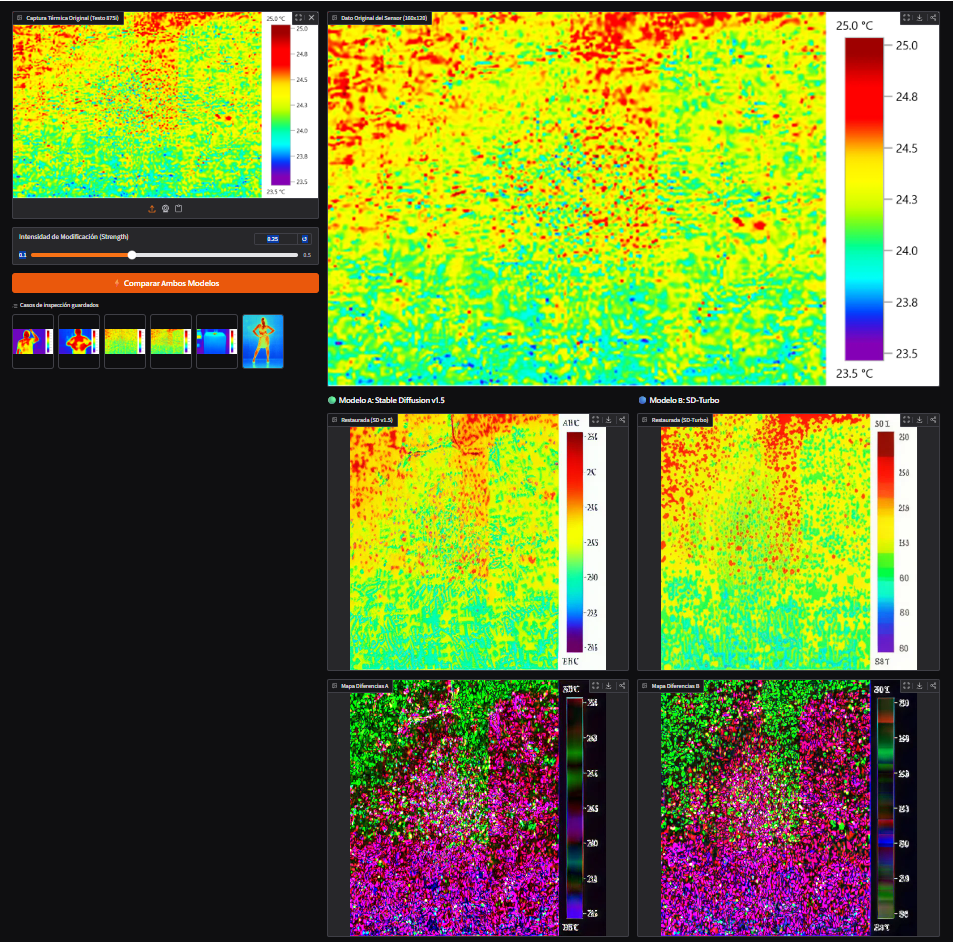
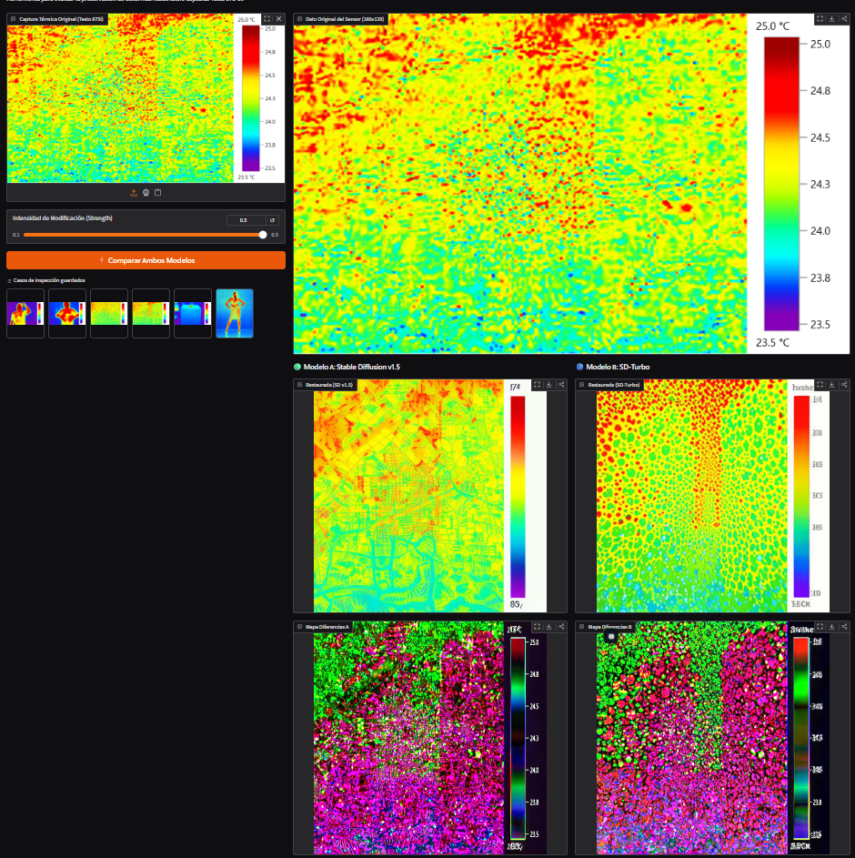
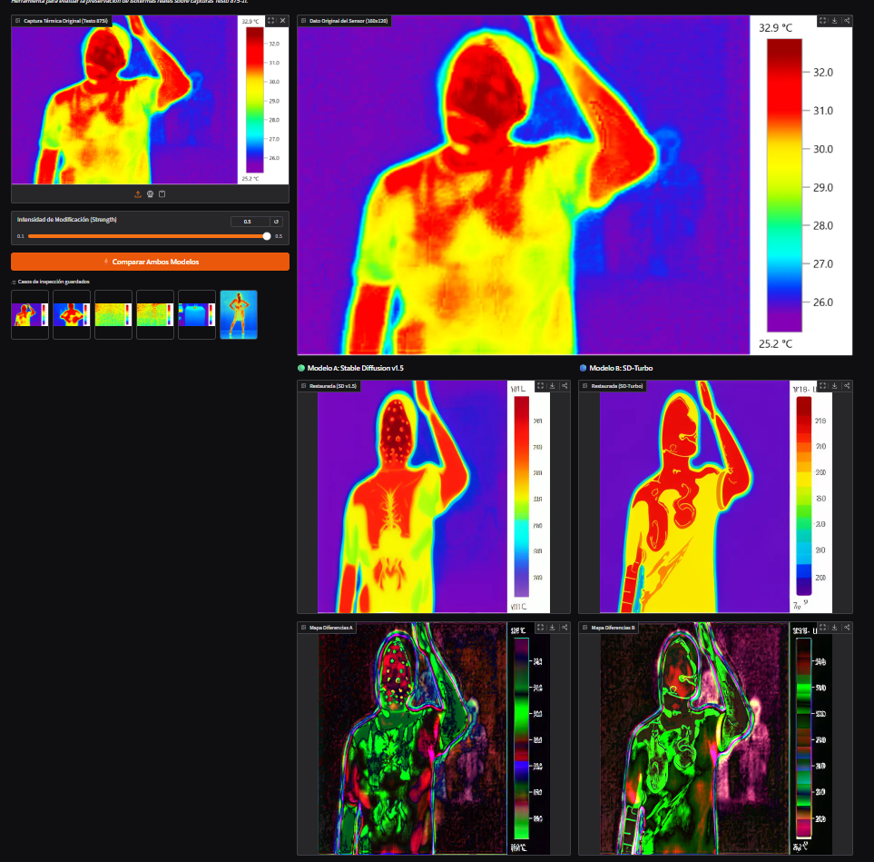

# Evaluación de Imágenes Termográficas con Difusión

> Herramienta local de evaluación comparativa para aplicar modelos de difusión sobre capturas termográficas industriales (`160×120` px) y auditar qué información conserva el sensor frente a qué detalles inventa la IA.

## Descripción

Este proyecto permite evaluar el impacto de aplicar modelos de difusión generativa (`Stable Diffusion v1.5` y `SD-Turbo`) sobre capturas infrarrojas de baja resolución nativa (`160 × 120` píxeles) tomadas con una cámara portátil **Testo 875-1i**, sin inducir falsos diagnósticos en tareas de mantenimiento predictivo.

A diferencia de un "mejorador" convencional, la herramienta enfrenta en la misma pantalla la captura original del detector contra ambas salidas generativas, sus **mapas de diferencias** píxel a píxel, una auditoría preventiva de coherencia térmica (`MobileNetV2`), un análisis visual cualitativo (`SigLIP`) y un aviso explícito de integridad metrológica.

## Persona Usuaria

* **Nombre:** Marcelo Gómez (26 años)
* **Ocupación:** Técnico electromecánico de planta; realiza relevamientos termográficos en tableros de distribución eléctrica, centros de transformación y paneles fotovoltaicos con una cámara Testo 875-1i (detector FPA no refrigerado de `160 × 120` px, sensibilidad térmica `< 50 mK`, rango espectral `8–14 µm`).
* **Problema:** Las capturas nativas lucen pixeladas al pegarlas en informes ejecutivos, pero los filtros tradicionales difuminan los límites térmicos y la IA generativa sin control puede inventar microtexturas o suavizar puntos calientes (*hotspots*).
* **Solución:** Una interfaz web local en Gradio que compara lado a lado la captura real contra dos modelos generativos, permite inspeccionar qué píxeles cambiaron y advierte explícitamente qué parte fue generada por IA.

## La paradoja entre lo real y lo inventado

> **Criterio central:** Restaurar no equivale a recuperar información física perdida.

1. **Lo qué hace el modelo y lo qué no puede recuperar:** La cámara Testo 875-1i registra `160 × 120` píxeles (`19.200` lecturas directas de microbolómetros). Al reescalar a `512 × 512` píxeles (`262.144` puntos) mediante difusión latente, los `242.944` píxeles adicionales, los bordes suavizados y las microtexturas son **inferencias estadísticas generadas por la red**, no mediciones radiométricas reales. Además, ambos modelos alteran los números impresos en la barra lateral de temperatura.
2. **Cómo se ve en la aplicación:** La interfaz muestra la captura original junto a las dos salidas y sus mapas de diferencias (donde las zonas oscuras indican baja alteración y las zonas brillantes resaltan lo modificado por la IA).

   

3. **Advertencia a la persona usuaria:** Cada informe incluye un aviso obligatorio indicando que las microtexturas y gradientes añadidos son reconstrucciones probabilísticas sin calibración física del sensor Testo 875-1i, y que toda decisión técnica debe validarse sobre la captura original.
4. **Ejemplos concretos donde el modelo inventó o falló:**
   * **Patrones inventados sobre ruido (`termografia_ruido1.bmp`, intensidad `0.50`):** `SD-Turbo` inventa un patrón artificial tipo panal/burbujas sobre zonas ruidosas (SSIM `0.2945`, MAE `26.37`), mientras `SD v1.5` traza vetas inexistentes y ambos corrompen los dígitos de la escala térmica (`23.5–25.0 °C`).

     

   * **Detalles anatómicos inventados (`Strength = 0.50`):** `SD v1.5` introduce manchas rojas falsas en el rostro (`92.7%` de ruido/artefactos según SigLIP) y `SD-Turbo` dibuja un patrón circular inexistente en el pecho.

     

5. **Cómo verificar el resultado:** Contrastando siempre contra el panel **"Dato Original del Sensor"**, revisando dónde se ilumina el **Mapa de Diferencias** y validando la temperatura real sobre el archivo nativo `.bmt` en el software calibrado del fabricante (*testo IRSoft*).

## Características

* Comparación simultánea lado a lado: **Original** vs. **Stable Diffusion v1.5** vs. **SD-Turbo**.
* **Mapas de diferencias matriciales** (`|I_orig - I_rest| × 3.0`) y deslizador de intensidad acotado (`Strength` de `0.10` a `0.50`).
* **Análisis visual cualitativo Zero-Shot** con `SigLIP` y **auditoría preventiva** con `MobileNetV2`.
* **Benchmark cuantitativo** independiente (`001_evaluar_metricas.py`) con PSNR, SSIM y MAE frente a interpolación bicúbica clásica.

## Herramientas Utilizadas

* **Entorno:** Python 3.12, `uv` (`pyproject.toml` y `uv.lock`).
* **Interfaz:** Gradio (`gr.Blocks`).
* **Modelos de IA (Hugging Face / PyTorch):**
  * `runwayml/stable-diffusion-v1-5` (v1-5 — Licencia **CreativeML OpenRAIL-M**) — difusión latente multipasos (`DPMSolverMultistepScheduler`).
  * `stabilityai/sd-turbo` (destilado de SD 2.1 — Licencia **Stability AI Community License**) — difusión destilada rápida en 1–4 pasos.
  * `google/siglip-base-patch16-224` (Licencia **Apache 2.0**) — clasificación visual *zero-shot* (`transformers`, `sentencepiece`, `protobuf`).
  * `MobileNetV2` (`torchvision`, pesos `IMAGENET1K_V1` / `DEFAULT`) — auditoría cromática preventiva de paleta térmica.
* **Procesamiento y métricas:** Pillow, NumPy, `scikit-image` (PSNR, SSIM, MAE).
* **Hardware con el que se probó:** AMD Ryzen 7 8845HS w/ Radeon 780M Graphics (3.80 GHz), 32.0 GB de RAM (31.3 GB usable), GPU NVIDIA GeForce RTX 4060 Laptop (8 GB VRAM), Windows 64 bits (x64) — Pruebas locales ejecutadas en **CPU** (con alternativa de aceleración CUDA o ejecución en GPU mediante Google Colab).

## Arquitectura del Sistema

```text
Captura Térmica Infrarroja (assets/ejemplos/*.bmp | *.jpg)
       │
       ▼
[ Preprocesamiento (src/diffusion.py) ]
  ├── Conversión estricta a RGB
  └── Reescalado Lanczos a 512×512 (múltiplo de 8 para estabilidad del VAE)
       │
       ├──────────────────────────────────────┐
       ▼                                      ▼
[ Modelo A: SD v1.5 ]                  [ Modelo B: SD-Turbo ]
       │                                      │
       ├──────────────────┬───────────────────┤
       ▼                  ▼                   ▼
[ src/honesty.py ]  [ src/classifier.py ] [ src/analysis.py ]
Mapa de diferencias  Auditoría MobileNetV2  Análisis SigLIP
       │                  │                   │
       └──────────────────┴───────────────────┘
                          │
                          ▼
       Interfaz Gradio (002_app.py) + Aviso Metrológico
```

### Estructura del Repositorio

```text
auditoria-termografia-difusion/
├── 001_evaluar_metricas.py        # Benchmark cuantitativo (PSNR, SSIM, MAE vs. bicúbica)
├── 002_app.py                     # Aplicación web interactiva en Gradio
├── src/
│   ├── __init__.py
│   ├── diffusion.py               # Carga en caché (_modelos_cargados) y pipelines A/B
│   ├── honesty.py                 # Mapas de diferencias y aviso metrológico obligatorio
│   ├── classifier.py              # Auditoría preventiva con MobileNetV2
│   ├── analysis.py                # Clasificación visual Zero-Shot con SigLIP
│   └── utils.py                   # Utilidades compartidas
├── assets/
│   ├── ejemplos/                  # 7 capturas térmicas de prueba (.bmp / .jpg)
│   └── *.png                      # Capturas recortadas de la interfaz funcionando
├── colab/
│   └── ejecutar_en_colab.ipynb    # Alternativa reproducible con GPU en Google Colab
├── AGENTS.md                      # Instrucciones y reglas para agentes de IA
├── bitacora.md                    # Registro iterativo (Construir, Medir, Aprender)
├── pyproject.toml                 # Dependencias del proyecto
└── uv.lock                        # Versiones exactas reproducibles
```

## Instalación y Ejecución

### Requisitos
* Python 3.12 y `uv` instalados.
* Espacio libre suficiente en disco (~8–10 GB para descargar los pesos de Hugging Face en la primera ejecución).

### Pasos (Ejecución Local con `uv`)

```bash
git clone https://github.com/19013492-eng/auditoria-termografia-difusion.git
cd auditoria-termografia-difusion
uv sync
uv run 002_app.py
```

Abrí en el navegador la URL local que informa la terminal (por defecto `localhost:7860`).

Para ejecutar el benchmark cuantitativo independiente:

```bash
uv run 001_evaluar_metricas.py
```

### Alternativa: Google Colab (con GPU)

Si querés acelerar la inferencia en GPU sin configurar CUDA localmente, abrí y ejecutá **`colab/ejecutar_en_colab.ipynb`** en Google Colab activando un entorno de ejecución con GPU T4 y utilizando el enlace temporal generado por Gradio.

## Ejecución de pruebas

1. Ejecutá `uv run 002_app.py` y abrí la URL local provista por Gradio.
2. Subí una imagen térmica (`.bmp`, `.jpg` o `.png`) o seleccioná uno de los 7 casos precargados en `assets/ejemplos/`:

| Archivo | Escena / Objeto evaluado | Propósito de prueba |
| :--- | :--- | :--- |
| `IV_00265.bmp` | Persona y reflejo de otra persona detrás a través de un vidrio | Evaluar contraste térmico y reflejos |
| `IV_00266.bmp` | Persona en escena térmica | Caso adicional de contraste térmico |
| `IV_00279.bmp` | Equipo de climatización del laboratorio seteado a ~24 °C | Imagen fuera de foco y muy ruidosa |
| `termografia_ruido1.bmp` | Escena térmica de baja amplitud (`23.5–25.0 °C`) | Evaluar detalles inventados sobre ruido granular |

3. Ajustá el deslizador **Intensidad de Modificación (`Strength`)** entre `0.10` y `0.50` (valor inicial `0.25` para preservar mejor isotermas).

4. Hacé clic en **Comparar Ambos Modelos** y revisá las salidas, los mapas de diferencias y el reporte técnico inferior.

### Métricas Cuantitativas Obtenidas (CPU, `001_evaluar_metricas.py`)

| Método | PSNR (dB) | SSIM (0–1) | MAE Píxeles |
| :--- | :---: | :---: | :---: |
| Bicúbica Clásica (Sin IA) | 51.18 | 0.9993 | 0.17 |
| Modelo A (`SD v1.5`) | 22.36 | 0.6966 | 9.70 |
| Modelo B (`SD-Turbo`) | 22.29 | 0.7211 | 10.12 |

* **PSNR (** **Peak Signal-to-Noise Ratio** **, en dB):** Mide qué tan parecidos son los píxeles frente a la captura original reescalada (`512×512` Lanczos); un valor más alto indica menos alteración.
* **SSIM (** **Structural Similarity Index Measure** **, 0–1):** Mide qué tanto se conservan la forma, los bordes y el contraste frente a la referencia (`1.0` significa imágenes idénticas).
* **MAE Píxeles (** **Mean Absolute Error** **):** Mide cuánto cambió en promedio cada canal de color de cada píxel (en escala `0–255`) respecto a la captura original reescalada; cuanto más cerca de `0`, menos cambió los colores térmicos.

* **Nota clave:** Estas métricas comparan parecido contra la imagen reescalada, **no confirman que los datos térmicos sean verdaderos**.
``SD-Turbo` respetó mejor las formas (mayor SSIM) y `SD v1.5` alteró un poco menos los píxeles (menor MAE), pero ambos quedan lejos del reescalado clásico. Estas métricas solo miden parecido con la captura original, **no confirman que los datos térmicos sean verdaderos**.

## Decisiones de Diseño

* **Por qué Gradio:** `gr.Blocks` permite mantener los pipelines pesados cacheados en memoria (`_modelos_cargados`) sin recargar pesos en cada interacción, y organizar en columnas la comparación original vs. A vs. B.
* **Por qué SD v1.5 + SD-Turbo:** Contrastar difusión latente multipasos (`DPMSolver`) frente a destilación rápida (`1–4` pasos) evidencia en vivo cómo varía el equilibrio entre inventar texturas y preservar la macroestructura.
* **Por qué SigLIP (`google/siglip-base-patch16-224`):** Permite evaluar descripciones cualitativas en lenguaje natural (nitidez, ruido/artefactos, borrosidad, saturación) sin entrenar un clasificador desde cero.
* **Principios de Human-AI Interaction (HAI) aplicados:**
  * **Transparencia:** La captura original nunca se oculta y se compara frente a frente con los mapas de diferencias.
  * **Control:** Deslizador acotado (`0.10–0.50`) para evitar modificaciones inventadas extremas.
  * **Explicabilidad:** Reporte en español con porcentajes SigLIP y dictamen comprensible para el técnico.
  * **Honestidad sobre lo generado:** Aviso metrológico obligatorio al pie del reporte.
  * **Manejo de errores:** Validación de entrada vacía (`gr.Error`), conversión automática a `"RGB"` para formatos `.bmp`/`.png` y ajuste compatible con el VAE para evitar caídas del pipeline.

## Conceptos de Procesamiento Digital Aplicados

* **Muestreo y resolución espacial:** Análisis del sensor FPA de `160 × 120` px frente al reescalado a `512 × 512` px.
* **Interpolación clásica:** Uso de Lanczos en el preprocesamiento del VAE y bicúbica como línea base cuantitativa.
* **Operaciones aritméticas matriciales:** Resta absoluta píxel a píxel (`|I_orig - I_rest|`) con factor de realce (`×3.0`) para construir los mapas de diferencias en `src/honesty.py`.
* **Reducción de ruido (*denoising*) y métricas de calidad:** Evaluación comparativa mediante PSNR, SSIM (Wang et al., 2004) y MAE.

## Uso de Agentes IA

* **Herramientas utilizadas:** `[ Gemini / Copilot en VS Code]`
* **Qué decidí yo:** Selección del dominio de termografía industrial (Testo 875-1i), definición de la persona usuaria (Marcelo Gómez), comparación dual `SD v1.5` vs. `SD-Turbo`, selección de las 7 capturas de prueba, límites seguros de `Strength` y validación manual de cada detalle inventado.
* **Qué propuso el agente y cómo lo revisé:** Modularización en `src/`, cálculo del mapa de diferencias, ajuste a `512 × 512` para el VAE y depuración de dependencias (`sentencepiece`, `protobuf`) y errores de entorno/disco en Windows; cada cambio fue probado localmente con las capturas reales.
* **Qué descarté:** Se descartó ocultar la captura original o limitarse a un filtro clásico liviano tras comprobar que la comparación dual demostraba mucho mejor dónde inventa un difusor.

## Limitaciones Conocidas

* **Ejecución lenta en CPU:** Cuando PyTorch corre en CPU (sin compilación CUDA activa), cada inferencia completa tarda varios minutos; para acelerar con GPU se incluye `colab/ejecutar_en_colab.ipynb` (o se requiere instalar PyTorch con soporte CUDA para la RTX 4060).
* **Clasificador `MobileNetV2` genérico:** Sin ajuste fino sobre paletas térmicas específicas, devolvió confianzas bajas y estables (`~33.9%`, *Dudosa / Revisión Manual*) tanto en originales como en salidas; actúa solo como alerta preventiva y no como validador absoluto.
* **Sin lectura radiométrica cruda (`.bmt`):** El sistema opera sobre imágenes RGB exportadas (`.bmp`/`.jpg`), no sobre matrices térmicas propietarias del fabricante.
* **Alteración de texto embebido:** Ninguno de los dos modelos de difusión preserva los números de la barra térmica lateral al modificar la imagen.

## Trabajo Futuro

* [ ] Incorporar lectura directa de archivos radiométricos (`.bmt` / `.csv`) para validar temperaturas reales.
* [ ] Reemplazar el clasificador `MobileNetV2` genérico por un modelo ajustado sobre paletas térmicas industriales reales.
* [ ] Agregar en la interfaz un visor opcional de referencia para la foto visible (`640 × 480` px) de la cámara Testo 875i.
* [ ] Analizar mediante una búsqueda bibliográfica más profunda otros factores que afectan la calidad de las imágenes, como el detalle del entorno y la emisividad de los cuerpos que rodean al objeto a evaluar.

## Reflexiones y Aprendizajes

La evaluación de imágenes termográficas permitió comprender que, en procesamiento digital de imágenes, restaurar no equivale a recuperar información física. Al aumentar una captura térmica de `160 × 120` a `512 × 512` píxeles, los detalles no registrados por el sensor corresponden a inferencias del modelo, no a mediciones reales.

Los principales desafíos fueron configurar un entorno reproducible con `uv` en Windows, resolver errores de espacio en disco y adaptar las imágenes `.bmp` a formato RGB y resolución `512 × 512`. El uso de asistentes de IA facilitó la organización del código y la depuración, aunque requirió revisar y validar cada cambio. Al comparar `Stable Diffusion v1.5` y `SD-Turbo` con la imagen original, se observó que una termografía mejorada puede parecer más nítida, pero incluir patrones inventados o escalas térmicas deformadas; por ello, una imagen generada por IA no debe reemplazar una medición verificable y real.

## Referencias

* Hoja de datos técnica **testo 875i** (Testo).
* Wang, Z., Bovik, A. C., Sheikh, H. R., & Simoncelli, E. P. (2004). *Image Quality Assessment: From Error Visibility to Structural Similarity*. IEEE Transactions on Image Processing.
* Modelos en Hugging Face: `runwayml/stable-diffusion-v1-5`, `stabilityai/sd-turbo` y `google/siglip-base-patch16-224`.

## Autor

**Rocío Napán Maldonado**  
Estudiante de Tecnicatura Superior en Ciencias de Datos e IA — IFTS N° 24  
Materia: Procesamiento Digital de Imágenes e Introducción a Visión por Computadora (2026)  
GitHub: `19013492-eng`

## Licencia

Este proyecto se distribuye bajo licencia **MIT** (sujeto a las licencias individuales de los modelos de Hugging Face listados en *Herramientas Utilizadas*).

---
**Trabajo Integrador N°2 — IFTS 24 — 2026**
